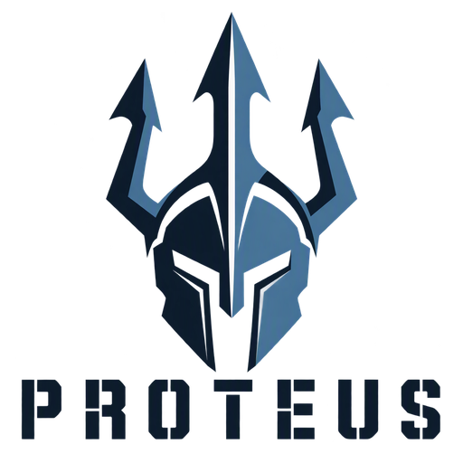
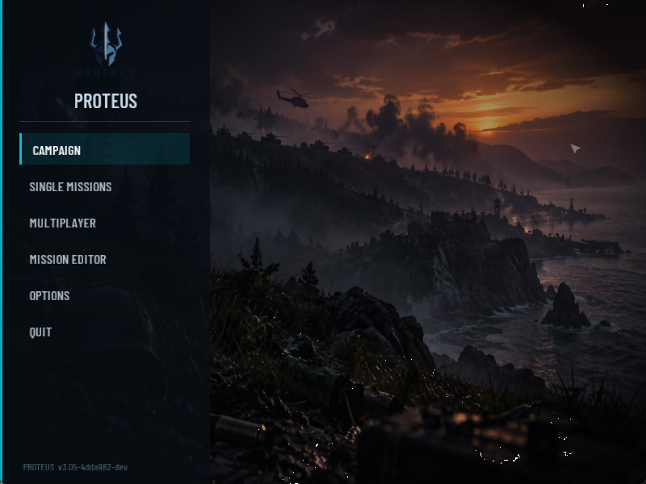
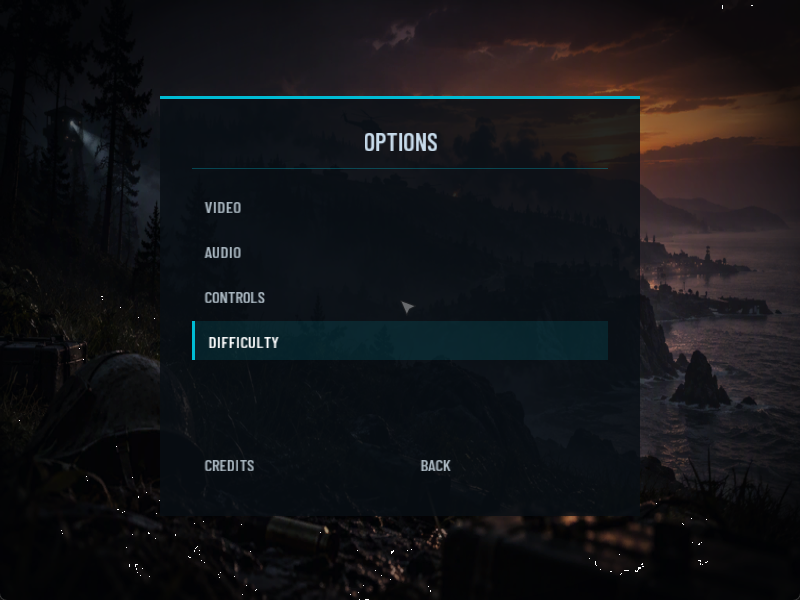
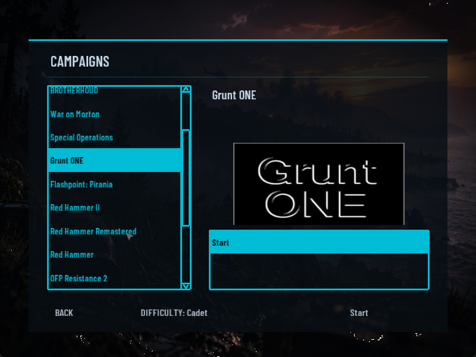

<h1 align="center">Proteus</h1>

<p align="center">
  
</p>

<p align="center">
  <b>A modern front end and engine for Operation Flashpoint: Cold War Crisis, built on OpenPoseidon.</b>
</p>

Proteus is a fork of [Open Poseidon Engine](https://github.com/koosoli/OpenPoseidon), the
community continuation of the Poseidon engine behind Operation Flashpoint: Cold War Crisis
and Arma: Cold War Assault. The fork keeps the engine, the data formats and the missions,
and replaces the original menus with a streamlined, resolution-aware design.

<p align="center">
  
</p>

## What is different in Proteus

- **A new main menu.** A full-bleed Proteus backdrop, a sidebar with the logo, and six
  items: Campaign, Single Missions, Multiplayer, Mission Editor, Options and Quit.
- **A shared design system.** Colours, sizes, the themed button and the backdrop
  pieces live in one module (`engine/Poseidon/UI/ProteusTheme.*`). A screen opts in
  with one call.
- **Restyled screens.**

  | Screen | Status |
  | --- | --- |
  | Main menu | Done |
  | Options (main page) | Done. Video, Audio, Controls and Difficulty pages are still the original look |
  | Campaign select | Done. Campaign list on the left, overview and mission history on the right |
  | Single missions | Done. Mission list on the left, overview on the right |
  | Mission editor | Dialogs restyled (unit, group, marker, sensor, waypoint, effects), with a 3D sample of the selected unit in Insert Unit and its own loading image |
  | Debriefing | Rebuilt as a flat after-action report: verdict banner, score, time, enemy killed and losses cards, then objectives, report and statistics panels |
  | In-game unit info | Restyled with the Proteus font, colours and bars |
  | Multiplayer, Mission Editor launcher | Planned |

- **Fonts and art.** Barlow Condensed (SIL Open Font License, included in `assets/fonts`)
  and the Proteus artwork in `assets/ui`.
- **Cleaner options.** The Mods and Local Maps entries are removed from the main menu for
  now. Local Maps crashes when opened and Mods has no working route yet.

Gameplay and the mission scripting are unchanged in this fork. The editor, debriefing and
unit info restyling is a mix of engine code (in this repository) and dialog layouts
(`resource.cpp` in a content mod, not included here). Those screens have not yet been
tested through a full mission.

## Renderer and backend work

- **DirectX 12 now runs on AMD RDNA 4.** `Start.ps1 -Dx12` used to crash inside AMD's
  shader compiler on an RX 9070 XT. Bisecting the shaders found it: four texture loads in
  the fog sun-reach function. It now loads three and derives the fourth, with an identical
  result. The terrain and object pipelines both compile.
- **FSR 4.1.1 works.** The engine's FSR 4 backend targets FidelityFX SDK 2.3. Fixing a
  call that passed the context handle where the API wants a pointer to it let it reach a
  working upscale. Copy `amd_fidelityfx_loader_dx12.dll` and `amd_fidelityfx_upscaler_dx12.dll`
  from the SDK's `signedbin` folder beside the exe (not included, AMD licence).
- **UI over the tonemapped image.** 3D models in menus (the editor unit sample) now draw in
  a display-referred pass after tonemapping, fixing the validation errors that stalled it.
- **Performance telemetry.** Every 300 frames the log prints average and 95th-percentile
  milliseconds per phase (sim, draw prep, landscape, objects, post, HUD, sound, swap),
  frames per second and draw calls, so optimisation starts from measurements.
- **Better crash reports.** Stack traces go 120 frames deep instead of 40.

The renderer already includes ambient occlusion, bounced-light probes, GPU-driven culling,
temporal anti-aliasing, volumetric smoke, layered fog, water, bloom and several upscalers.
Planned: a gameplay performance baseline, then optimisation of the hottest phase.

<p align="center">
  
  
</p>

## Requirements

- Your own legal copy of Operation Flashpoint: Cold War Crisis or Arma: Cold War Assault.
  Proteus does not include any game data (`Dta`, `Res`, `Addons`, `Campaigns`, `MPMissions`,
  or the mods themselves). Point the launcher at your install.
- Windows 10 or 11. Proteus has only been built and tested on Windows.

## Building

Follow the upstream build guide in [`BUILDING.md`](BUILDING.md). The short version, from
the repository root in PowerShell:

```powershell
$env:VCPKG_ROOT = 'C:\dev\vcpkg'
.\scripts\Build.ps1 -Preset win-x64-clang-rwdi -Target PoseidonGame
```

The build writes to `dist/x64-win-rwdi`.

## Running

Copy `mods.example.json` to `mods.json` (it is gitignored) and point it at your game
folder and mods. Then start the game:

```powershell
.\scripts\Start.ps1
```

Use `-Fullscreen` for fullscreen. `-LogFile` writes the engine log to a file.

## Documentation

- [`docs/UI_SCREENS.md`](docs/UI_SCREENS.md): every full-window screen and its Proteus status.
- [`docs/CHANGELOG.md`](docs/CHANGELOG.md): what changed in the fork, newest first.
- [`docs/FORK_ROADMAP.md`](docs/FORK_ROADMAP.md): planned work.
- [`docs/ASSET_PIPELINE.md`](docs/ASSET_PIPELINE.md): how game assets and licences are handled.
- [`docs/KNOWN_ISSUES.md`](docs/KNOWN_ISSUES.md): open problems and workarounds.
- [`docs/UPSTREAM_README.md`](docs/UPSTREAM_README.md): the original Open Poseidon Engine README, with its engine feature list.

## Credits and licence

- **Open Poseidon Engine** is by [koosoli](https://github.com/koosoli) and contributors. See
  [`CREDITS.md`](CREDITS.md) and [`THIRD_PARTY_NOTICES.md`](THIRD_PARTY_NOTICES.md).
- **Bohemia Interactive** developed Operation Flashpoint and released the Cold War Assault
  source code under the GNU General Public License v3.0 or later, with the additional terms
  in [`LICENSE`](LICENSE).
- **Barlow Condensed** by Jeremy Tribby, under the SIL Open Font License 1.1
  ([`assets/fonts/OFL.txt`](assets/fonts/OFL.txt)).

Proteus is a community project. It is not affiliated with or endorsed by Bohemia Interactive.
